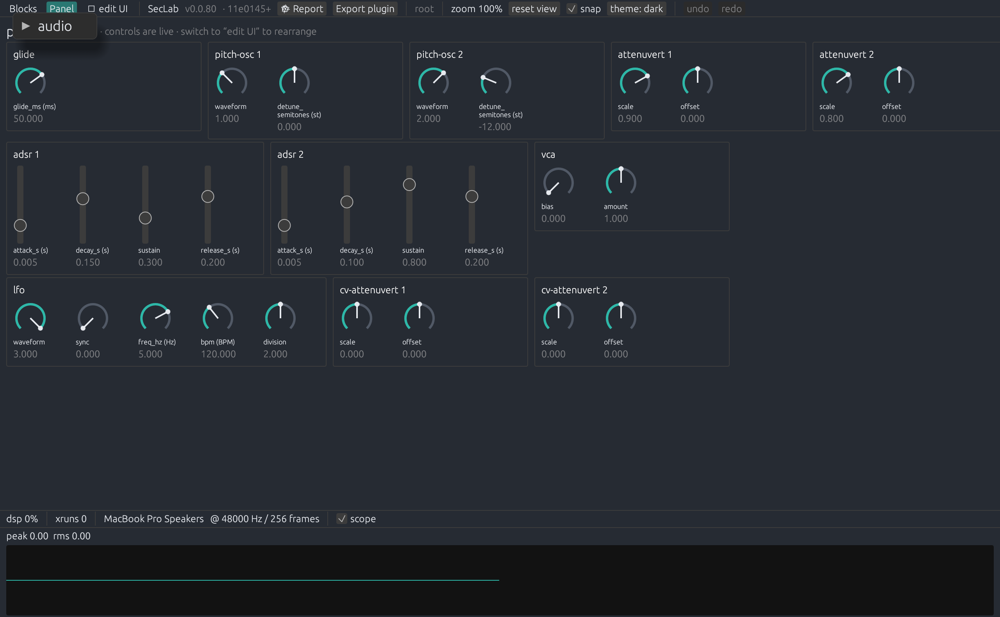
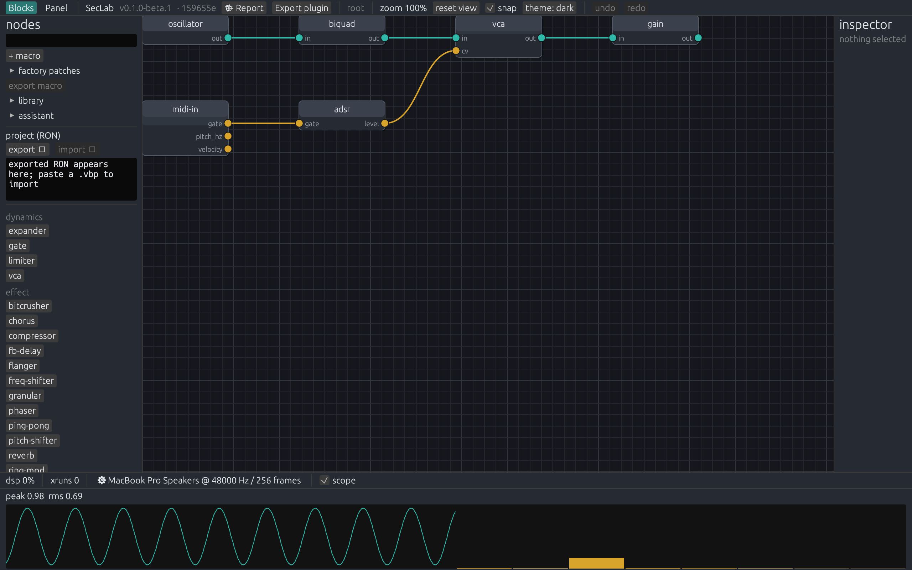

# SecLab

**Build your own synths and effects visually — and export each one as a real VST3 / AU / CLAP
plug-in.** No coding required.

[](https://github.com/ice1x/SecLab/releases)
[](https://github.com/ice1x/SecLab/actions/workflows/ci.yml)



Wire oscillators, filters, envelopes, effects and modulators together, hear the result in real
time, play it from your MIDI keyboard — then press **Export plugin** and the patch shows up in
your DAW as its own instrument. A built-in **AI assistant** turns a plain-language description
("a warm detuned bass with a slow filter sweep") into a patch you can audition and tweak.

> **Public beta.** SecLab is free to use during the beta, including for music you release.
> Expect rough edges — please [report bugs](#feedback) so they get fixed.

## Features

- **Visual patching** — an infinite canvas of blocks and wires with typed ports (audio, CV,
  gate, MIDI), undo/redo, snapping, nested **macros** you can save and reuse.
- **86 DSP blocks** in 11 groups: oscillators (VA, wavetable, FM, noise, Karplus–Strong, modal
  resonators), filters (ladder, state-variable, biquad, formant…), envelopes, LFOs, sequencers,
  math, routing, dynamics and effects (reverb, delays, chorus, phaser, granular, spectral freeze,
  vocoder, wavefolder…). See the [node reference](docs/nodes.md).
- **Panel view** — every patch gets a playable control surface of knobs and sliders, live while
  you play; rearrange it in *edit UI* mode.
- **49 factory patches** to start from — classic-inspired synths (Minitaur, Minimoog, Juno-60,
  MS-20, SH-101, TB-303, Minilogue…), pads, leads, basses, drums and effects.
- **Export plugin** — name the patch and SecLab installs it as its own CLAP + VST3 + AU
  (macOS), a separate instrument in your DAW. Export as many as you like; re-exporting updates
  one. No compiler needed.
- **AI assistant** — describe a sound, get a validated patch. Works with Anthropic, any
  OpenAI-compatible API, or a **local model** (Ollama, LM Studio, llama.cpp) with no key and
  nothing leaving your machine. API keys live in the OS keychain only.
- **Runs everywhere you make music** — CLAP, VST3 and AUv2 plug-ins with the full editor inside
  the DAW, plus a standalone app with audio device and MIDI keyboard selection, an oscilloscope
  and a spectrum view.
- **Built-in bug reporter** — *Report* files a GitHub issue with the log attached (opt-in,
  shows you exactly what is sent).



## Use cases

- **Sound design** — build a synth or effect from parts instead of hunting for a plug-in that
  almost does it.
- **Music production** — turn a patch you like into a plug-in and use it in every project.
- **Learning synthesis** — the factory patches are small, readable graphs: open one, see how a
  classic voice is wired, change a block and hear the difference.
- **Rapid prototyping** — try an idea for an instrument or effect in minutes, then keep it.

## Download

Get the latest build from the **[Releases](https://github.com/ice1x/SecLab/releases)** page.

| Platform | Files |
| --- | --- |
| macOS (Apple Silicon, macOS 11+) | `SecLab-<version>-macOS-arm64.pkg` installer, or per-format zips |
| Windows (x64) | `SecLab-<version>-Windows-x86_64.zip` — CLAP, VST3, standalone |
| Linux (x86-64) | `SecLab-<version>-Linux-x86_64.zip` — CLAP, VST3, standalone |

`SHA256SUMS.txt` on each release lists the checksums.

### macOS: installing the beta

1. Open **`SecLab-<version>-macOS-arm64.pkg`**. It installs the CLAP, VST3, AU and the
   standalone app into `/Library/Audio/Plug-Ins` and `/Applications` (untick formats you don't
   want under *Customize*).
2. The beta is not notarized by Apple yet, so macOS first says it *cannot verify the
   developer*. Click **Done**, open **System Settings → Privacy & Security**, scroll down and
   click **Open Anyway** next to the SecLab installer, then run it again.
3. Rescan plug-ins in your DAW. SecLab appears as **ice1x: SecLab** (AU) / **SecLab**
   (VST3, CLAP).

**Using the zips instead?** Move each bundle into place, then remove the download quarantine —
only for files from the official release page:

```sh
sudo xattr -dr com.apple.quarantine "/Library/Audio/Plug-Ins/CLAP/seclab-plugin.clap"
sudo xattr -dr com.apple.quarantine "/Library/Audio/Plug-Ins/VST3/seclab-plugin.vst3"
sudo xattr -dr com.apple.quarantine "/Library/Audio/Plug-Ins/Components/seclab-plugin.component"
sudo xattr -dr com.apple.quarantine "/Applications/seclab-plugin.app"
```

The VST3, AU and app load the CLAP at runtime, so always install the CLAP as well.

### Windows and Linux

Copy `seclab-plugin.clap` and `seclab-plugin.vst3` into your CLAP and VST3 folders — Windows:
`C:\Program Files\Common Files\CLAP` and `…\VST3`; Linux: `~/.clap` and `~/.vst3` — and run
`seclab-standalone` for the standalone editor. Builds are unsigned; Windows SmartScreen may warn
on first launch (*More info → Run anyway*). Export plugin is macOS-only for now.

## Getting started

- [Build your first plugin](docs/first-plugin.md) — oscillator → filter → envelope → output.
- [Node reference](docs/nodes.md) — every block, its ports and parameters.
- Open **factory patches** in the left sidebar, switch between **Blocks** and **Panel** at the
  top left, and press **Export plugin** when a patch is ready.

## Feedback

Found a bug or missing something? Use **Report** in the app's toolbar, or open an issue on
[GitHub Issues](https://github.com/ice1x/SecLab/issues). Include your OS, DAW and plug-in format.

## License

Two documents, for two different things:

- **Official beta binaries — [Freeware Beta EULA](EULA-BETA.md).** The builds on the Releases
  page (standalone app + CLAP/VST3/AU plug-ins) are **free to download and use, including to make
  and sell music** — you just may not redistribute, modify or reverse-engineer them. The final
  release may ship under different terms.
- **Source code — [PolyForm Strict License 1.0.0](LICENSE).** Source-available, not
  open-source: you may read the code, but using, modifying, redistributing or commercializing it
  is not permitted. [`NOTICE`](NOTICE) lists the third-party components, which remain under
  their own, permissive licenses.

VST is a trademark of Steinberg Media Technologies GmbH. Audio Unit is a trademark of Apple Inc.

---

## For developers

SecLab is written in **Rust**: a real-time DSP graph engine, an [egui](https://github.com/emilk/egui)
editor (which also compiles to WASM), [nih-plug](https://github.com/robbert-vdh/nih-plug) for
CLAP and [clap-wrapper](https://github.com/free-audio/clap-wrapper) for VST3/AU/standalone.

```bash
# run the standalone editor
cargo run -p seclab-standalone

# build the VST3 / AU / CLAP bundles
cargo xtask bundle seclab-plugin

# tests / lint / format (required before every commit)
cargo test --workspace
cargo clippy --workspace --all-targets -- -D warnings
cargo fmt --all --check
```

Faster test runs: [`cargo nextest run`](https://nexte.st/) (config in
[`.config/nextest.toml`](.config/nextest.toml)); doctests via `cargo test --doc`.

- [Overview & design](docs/overview.md) — goals, stack & key decisions, the AI-assistant design.
- [Roadmap & backlog](docs/backlog.md) — epics and the full task checklist.
- [Adding your own node](docs/adding-a-node.md) — extend the DSP library.
- [Releasing](docs/releasing.md) — how a release is built, packaged and published.
- [CHANGELOG](CHANGELOG.md) — notable changes and the versioning policy.
- [`examples/`](examples) — the factory patches, each covered by tests.
